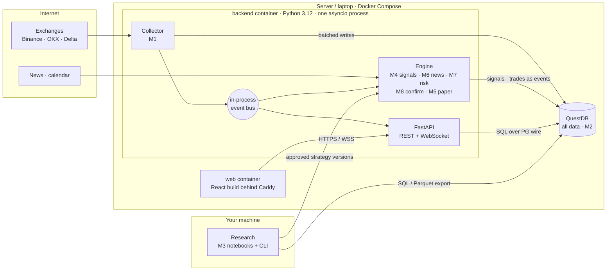
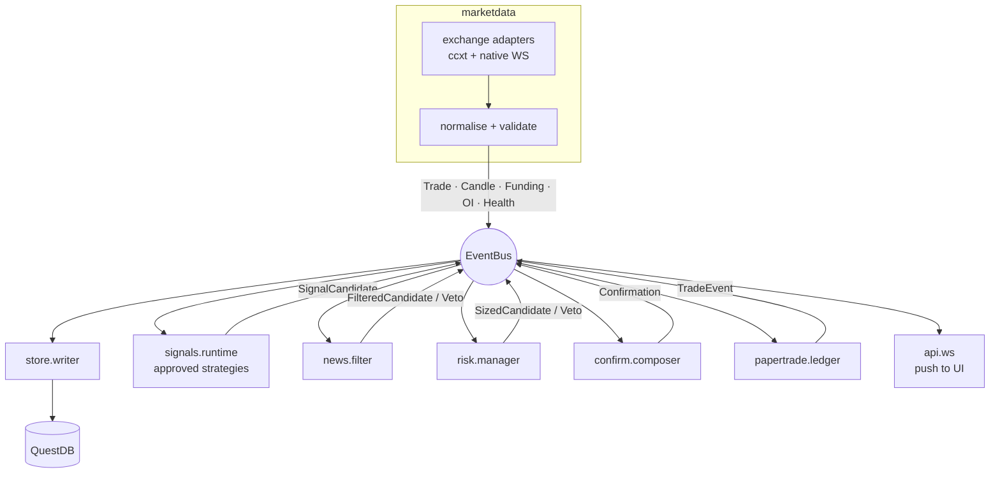

# Architecture

The **target** system: what we're building towards and the chosen stack. For what exists in code
_today_, see `PROJECT_MAP.md`. For module behaviour, see `docs/product/modules/`.

Guiding rule: **start with the fewest moving parts**; add infrastructure only when a real,
measured need appears. The decision log for each choice is in `DECISIONS.md`.

## 1 · System at a glance

Three containers, one database, one backend process.



**Why one backend process:** the latency budget is seconds (see DECISIONS: not HFT), and one
process is simplest to run, debug and deploy. Modules talk **only through typed events on the
bus**, never by calling into each other's internals. When a module needs to scale or be
rewritten (e.g. collector in Rust), swap the in-process bus for NATS/Redis without touching module
logic.

## 2 · Inside the backend



### Event contracts

- Defined once as **Pydantic v2 models** in `backend/src/tcs/common/events.py`. They are the
  only shared interface between modules.
- FastAPI publishes them in its OpenAPI schema; the frontend **generates TypeScript types** from
  it (`openapi-typescript`), so Python and TS never drift.
- Every event carries `event_id`, `ts` (UTC ms) and `source`. Prices and sizes use `Decimal` at
  the boundaries where money is calculated (risk, paper fills).

### Data model (QuestDB only)

| Table                                 | Kind        | Notes                                                       |
| ------------------------------------- | ----------- | ----------------------------------------------------------- |
| `candles`, `funding`, `open_interest` | market data | partitioned by day; dedup on key                            |
| `news_events`                         | market data | one row per tagged symbol                                   |
| `signal_events`                       | app events  | `created` / `vetoed` / `confirmed` / `expired`, append-only |
| `trade_events`                        | app events  | `opened` / `marked` / `closed`, append-only                 |
| `strategy_versions`                   | registry    | frozen params + code hash + report link                     |

Current state = latest event per id (`LATEST ON`). App data is append-only, which gives a full
audit trail. **PostgreSQL is deferred**: add it only if append-only app data proves painful in
Phase 3 (see DECISIONS).

## 3 · Folder structure (target)

The repo becomes a small monorepo. Today's React app moves to `apps/web/` in Phase 1.

```text
crypto_dashboard/
├─ CLAUDE.md                     # AI entry point (context map, rules)
├─ README.md
├─ docs/
│  ├─ context/                   # STATUS, PROJECT_MAP, ARCHITECTURE, ROADMAP, DECISIONS, TOOLING, MINDMAP
│  └─ product/                   # product overview + modules/M1…M9 specs
├─ apps/
│  └─ web/                       # React 19 + Vite+ (today's src/ moves here)
│     └─ src/
│        ├─ api/                 # generated types (openapi-typescript) + API/WS client
│        ├─ features/            # one folder per screen: markets/, confirmations/, strategies/, risk/, health/
│        ├─ components/          # shared UI pieces
│        └─ …                    # existing adapters/services stay until the API replaces them
├─ backend/                      # Python, managed by uv
│  ├─ pyproject.toml
│  ├─ src/tcs/                   # tcs = trade confirmation system
│  │  ├─ common/                 # config, logging, time, symbols, events.py (contracts), bus.py
│  │  ├─ marketdata/             # M1  adapters/, collector.py, health.py
│  │  ├─ store/                  # M2  writer.py, queries.py, backfill.py, quality.py, schema.sql
│  │  ├─ research/               # M3  features/, backtest/, stats/, reports/, gate.py
│  │  ├─ signals/                # M4  strategies/, runtime.py
│  │  ├─ papertrade/             # M5  ledger.py, fills.py, drift.py
│  │  ├─ news/                   # M6  sources/, classify.py, impact.py, filter.py
│  │  ├─ risk/                   # M7  sizing.py, limits.py, manager.py
│  │  ├─ confirm/                # M8  confidence.py, composer.py, alerts.py
│  │  ├─ api/                    # FastAPI app, routes/, ws.py
│  │  ├─ app.py                  # wires bus + modules, starts the process
│  │  └─ cli.py                  # `tcs collect | backfill | backtest | report | gate`
│  └─ tests/                     # mirrors src/tcs/; fixtures/ holds recorded exchange messages
├─ research/                     # notebooks (marimo), journal.md, exported reports/
├─ infra/
│  ├─ docker-compose.yml         # questdb, backend, web
│  └─ Caddyfile
├─ .claude/skills/               # project skills (new-exchange-adapter, backtest-report, …)
└─ .github/workflows/ci.yml      # web: build+lint+test · backend: ruff+pyright+pytest
```

Rules:

- `research/` code that proves useful **graduates** into `backend/src/tcs/research/` with tests;
  notebooks never import from each other.
- The **same strategy class** runs in backtest (M3), live signals (M4) and paper (M5).
- Module folders map 1:1 to `docs/product/modules/M*.md`.

## 4 · Packages

Adopt each package when its phase starts (P0 = now). Versions: latest stable at adoption, pinned
in the lockfile.

### Backend (Python)

| Area           | Package                                                                                                 | Why                                                | Phase |
| -------------- | ------------------------------------------------------------------------------------------------------- | -------------------------------------------------- | ----- |
| Project & deps | **uv**                                                                                                  | Fast installs, lockfile, Python version management | P1    |
| Lint + format  | **ruff**                                                                                                | One fast tool for both                             | P1    |
| Type check     | **pyright**                                                                                             | Strict typing, same spirit as our TS               | P1    |
| Tests          | **pytest**, pytest-asyncio, **hypothesis**                                                              | Unit + property tests (cost model, risk rules)     | P1    |
| Data models    | **pydantic** v2, pydantic-settings                                                                      | Event contracts, config from env                   | P1    |
| API            | **FastAPI**, uvicorn                                                                                    | REST + WebSocket, OpenAPI for TS types             | P1    |
| Exchanges      | **ccxt** (includes pro WebSockets)                                                                      | Unified REST/WS for 100+ exchanges; backfill       | P1    |
| HTTP / retries | httpx, tenacity                                                                                         | Non-ccxt sources (news), retry with backoff        | P1    |
| QuestDB        | **questdb** (official ingest client), **psycopg** 3                                                     | Fast ingest (ILP) + SQL queries                    | P1    |
| Logging        | structlog                                                                                               | JSON logs with context (exchange, symbol)          | P1    |
| CLI            | typer                                                                                                   | `tcs …` commands                                   | P1    |
| Dataframes     | **polars**, numpy                                                                                       | Features and analytics                             | P2    |
| Indicators     | TA-Lib (or pandas-ta)                                                                                   | Standard TA                                        | P2    |
| Backtesting    | **vectorbt** (screening); own event-driven engine _or_ NautilusTrader (validation, decided at P2 start) | Fast idea screening, then realistic validation     | P2    |
| Statistics     | scipy, statsmodels, arch                                                                                | Tests, regressions, cointegration, GARCH           | P2    |
| Reports        | quantstats, plotly                                                                                      | Strategy tear sheets                               | P2    |
| Optimisation   | optuna                                                                                                  | Param search inside walk-forward                   | P2    |
| Research       | marimo (or Jupyter), duckdb (optional, local)                                                           | Reactive notebooks; fast local scans of Parquet    | P2    |
| News NLP       | anthropic SDK or transformers (FinBERT)                                                                 | Classify and score news                            | P5    |
| Alerts         | python-telegram-bot                                                                                     | Confirmation alerts                                | P6    |

### Frontend (TypeScript), already: React 19, Vite+, react-router, eventemitter3, SCSS

| Package                                                                     | Why                                                                                                                                                   | Phase  |
| --------------------------------------------------------------------------- | ----------------------------------------------------------------------------------------------------------------------------------------------------- | ------ |
| **vitest** (via Vite+) ✅ adopted (191 tests)                               | Tests                                                                                                                                                 | done   |
| openapi-typescript                                                          | Types generated from the backend schema                                                                                                               | P1     |
| @tanstack/react-query                                                       | Request/response data (reports, history, candles): caching, refetch, retries. _Not_ for live ticks; those stay on WebSocket + `LiveMarketDataService` | P3     |
| **lightweight-charts** (TradingView) ✅ adopted (5.2, attribution required) | Candles + indicators                                                                                                                                  | done   |
| express, `@electric-sql/pglite`                                             | Backend prototype only; pglite unused. Removed when the Python backend lands                                                                          | remove |

## 5 · Tools

| Tool                          | Use                                                         | Phase     |
| ----------------------------- | ----------------------------------------------------------- | --------- |
| Docker + Docker Compose       | Run QuestDB + backend + web anywhere                        | P1        |
| QuestDB web console (`:9000`) | Ad-hoc SQL and quick charts                                 | P1        |
| GitHub Actions                | CI on every PR                                              | P0        |
| pre-commit                    | Run ruff/format/lint before each commit                     | P1        |
| just (or Make)                | One-word commands: `just dev`, `just test`, `just backfill` | P1        |
| Caddy                         | Serves the web build, automatic HTTPS                       | P1 deploy |
| Small VPS (~$5–20/mo)         | 24/7 collector + engine                                     | P1 deploy |
| Claude Code + skills/MCP      | See `TOOLING.md`                                            | now       |

## 6 · Migration path from today

1. **P0:** fix the broken build/runtime and data bugs, add CI. Frontend stays at the repo root.
   The TS backend prototype (`src/backend/`: Express, `node:sqlite`, Telegram) is frozen.
2. **P1 start:** `git mv` the frontend to `apps/web/`; scaffold `backend/` with uv; add
   `infra/docker-compose.yml` with QuestDB; collector writes candles/funding. Port the Telegram
   client and replay ideas from `src/backend/` to Python, then delete `src/backend/`.
3. **P1 end:** UI's connection badges read `/health` from the API; browser WebSockets remain only
   for the live price table until the API streams prices.
4. **P3:** UI switches fully to the backend API/WS; browser exchange adapters are deleted.
   Browser-side alert rules (`AlertEngine`) move server-side so alerts fire without an open tab.

## 7 · Scaling path (only when measured)

| Symptom                                            | Step                                                |
| -------------------------------------------------- | --------------------------------------------------- |
| Backend CPU-bound or one module blocks others      | Split into processes; bus → NATS or Redis Streams   |
| Append-only app data gets awkward                  | Add PostgreSQL for app state                        |
| Storing full tick/trade history (billions of rows) | ClickHouse for ticks; QuestDB stays for candles     |
| Latency proven to cost money in forward tests      | Rewrite that hot path (collector/execution) in Rust |
