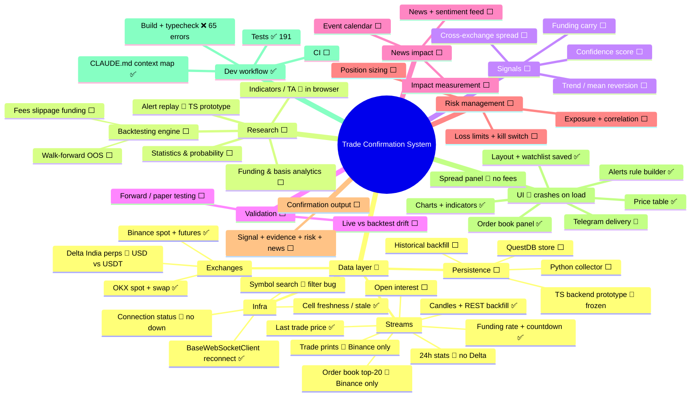

# Mind map

Renders as a diagram on GitHub (Mermaid). For an interactive, collapsible version paste the code
block's contents into <https://mermaid.live>.
Legend: ✅ built · 🚧 partial / has known issues · ⬜ planned.

