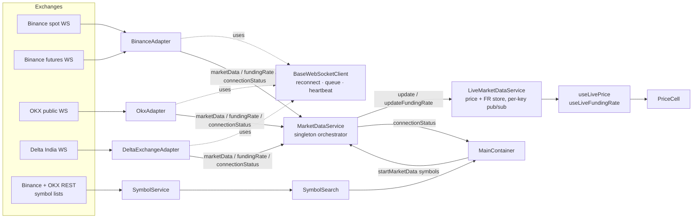

# Project map

What exists in code **today**. The target system is in `ARCHITECTURE.md`.

Stack: React 19 · TypeScript (strict) · Vite+ (`vite-plus`: Vite + oxlint + oxfmt) · SCSS ·
react-router 7 · eventemitter3. Browser-only, no backend.

## Data flow

## Files (one line each — keep in sync)

**Entry / shell**
- `index.html` → `src/main.tsx` (BrowserRouter) → `src/App.tsx` (Header + routes `/`, `/about`)
- `src/App.scss` — global theme variables (`.light` / `.dark` on `<html>`)

**Data layer**
- `src/websocket/BaseWebSocketClient.ts` — generic WS: JSON parse, send-queue until open,
  exponential backoff reconnect, optional heartbeat (unused)
- `src/adapters/BinanceAdapter.ts` — 2 sockets (spot, futures); `aggTrade` → price,
  `markPrice` → funding (futures only)
- `src/adapters/OkxAdapter.ts` — 1 socket; `tickers` (spot + `-SWAP`), `funding-rate`
- `src/adapters/DeltaExchangeAdapter.ts` — 1 socket; `trades`, `funding_rate`; USDT↔USD mapping
- `src/services/MarketDataService.ts` — owns adapters, connects them, routes events into
  `LiveMarketDataService`, aggregates per-market connection state per exchange
- `src/services/LiveMarketDataService.ts` — in-memory latest price/FR keyed `EXCHANGE|SYMBOL|TYPE`
- `src/services/SymbolService.ts` — REST symbol lists (Binance, OKX), search, popular list
- `src/custom-hooks/useLivePrice.ts`, `useLiveFundingRate.ts` — subscribe a component to one key
- `src/utils/symbolUtils.ts` — `parseOkxSymbol`, `formatCanonicalSymbol`
- `src/types/marketData.ts` (`GenericMarketData`, `CanonicalSymbol`),
  `src/types/connection.ts` (`ConnectionState`, `ConnectionStatusPayload`)

**UI**
- `src/components/MainContainer/` — dashboard page: symbol list state, starts streaming,
  renders search, metrics, connection badges, price table
- `src/components/dashboard/` — `PriceTable` → `PriceRow` → `PriceCell` (price + funding),
  `Metrics`, `ConnectionStatus` (global `.scss`, older style)
- `src/common-components/SymbolSearch/`, `RealTimeClock/`
- `src/components/Header/` (`Header`, `NavList`), `ThemeToggle/`, `AboutUs/`

## Event contracts

| Event | Emitted by | Payload |
| --- | --- | --- |
| `marketData` | adapters → `MarketDataService` | `GenericMarketData { exchange, symbol, type, currentPrice, timeStamp(ms) }` |
| `fundingRate` | adapters → `MarketDataService` | `{ exchange, symbol, fundingRate(%), nextFundingTime(ms), fundingInterval?(s), nextFundingRate? }` |
| `connectionStatus` | adapters | `ConnectionStatusPayload { exchange, market, state }` |
| `connectionStatus` | `MarketDataService` | `{ exchange, state }` aggregated (any live ⇒ live) |

## Endpoints

- Binance: `wss://stream.binance.com/ws`, `wss://fstream.binance.com/market/ws`,
  `https://api.binance.com/api/v3/exchangeInfo`
- OKX: `wss://ws.okx.com:8443/ws/v5/public`, `https://www.okx.com/api/v5/public/instruments`
- Delta India: `wss://public-socket.india.delta.exchange`
