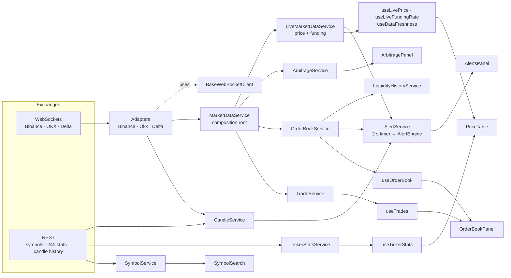

# Project map

What exists in code **today** (after the 2026-11-01 merge of master). The target system is in
`ARCHITECTURE.md`; the health of each part is in `STATUS.md`.

Stack: React 19 · TypeScript (strict) · Vite+ (`vp`: Vite, Vitest, oxlint, oxfmt) · SCSS ·
react-router 7 · eventemitter3 · lightweight-charts 5. Backend prototype: Node + Express +
`node:sqlite`.

## Data flow (browser)

`MainContainer` renders the panels in a user-ordered layout: metrics, connection status, chart,
price table, spread (arbitrage), order book, alerts.

## Files

**Entry / shell**

- `index.html` → `src/main.tsx` → `src/App.tsx`: `TopNav` + routes `/` (Dashboard),
  `/chart/:symbol` (Chart, lazy-loaded), `/markets` (older dashboard), `/about`
- `src/styles/tokens.css` (`--t-*` design tokens, dark), `src/styles/_page.scss` (page mixins)
- `src/components/MainContainer/`: dashboard; watchlist + panel layout state (persisted),
  starts streaming, renders panels in "Edit layout" order

**Exchange connectivity**

- `src/websocket/BaseWebSocketClient.ts`: reconnect/backoff/jitter, send queue, optional heartbeat
- `src/adapters/BinanceAdapter.ts`: combined streams; aggTrade (price + trade prints), bookTicker,
  depth20@100ms, klines + REST candle history, markPrice (funding)
- `src/adapters/OkxAdapter.ts`: tickers, funding-rate, candles + REST history
- `src/adapters/DeltaExchangeAdapter.ts`: trades, funding_rate (USD instruments mapped to `-USDT`)

**Services (singletons, `getInstance()` / `resetInstance()`)**

- `MarketDataService`: wires adapters → stores; `startMarketData`, `removeSymbol` (unsubscribes
  price/book/funding on all adapters and clears book/trade buckets)
- `LiveMarketDataService`: latest price/funding keyed `EXCHANGE|SYMBOL|TYPE`, per-key pub/sub
- `CandleService`: refcounted candle subscriptions, backfill, `loadMoreHistory` (scroll-back)
- `OrderBookService`, `LiquidityHistoryService`, `TradeService`: book snapshots, churn history,
  rolling trade prints
- `TickerStatsService`: 24 h change/volume via REST every 60 s
- `ArbitrageService`: cross-exchange last-price spread → `arbitrage` events
- `AlertEngine` (pure evaluation) + `AlertService` (live wiring, trigger log)
- `SymbolService`: REST symbol lists, search, popular list
- `MarketOverviewService`: Dashboard market data for the 10 research coins (Binance tickers,
  funding, OI, long/short; Fear & Greed; BTC dominance; liquidation stream); polls only while
  subscribed; each source `loading | ok | unavailable`
- `SetupStatsService`: pooled setup stats per (pattern TF, zone TF) context over the research
  universe, coin by coin with UI yields; priority requests first, others queued in the background
- `SetupAlertService`: setup-alert rules + firings (localStorage), 60 s check over the research
  universe, outcome tracking, Telegram via backend `/api/alerts/send` (injectable deps for tests)

**Hooks**: `useScan` (+ `useResearchScan`, `researchUniverse`), `useSetupAlerts`,
`useMarketOverview`, `useNow`, `useHistories` (one symbol, several TFs), `useSetupStats`,
`useLiveCandle` (Binance forming candle), `useLivePrice`, `useLiveFundingRate`, `useDataFreshness`, `useTickerStats`,
`useOrderBook`, `useTrades`, `useHistory`, `useConnectionSummary`

**Analysis engine (pure, unit-tested in `src/utils/__tests__/setupAnalysis.test.ts`)**:
`volumeProfile` (POC, value area, HVN/LVN), `zones` (demand/supply, tests/held/break), `patterns`
(double bottom, inverse head and shoulders, bull flag in-house; candlestick shapes from the `candlestick` package + our context; no
lookahead), `setupAnalysis` (location, outcome,
stats, `buildScan`), `stats` (Wilson interval), `format`. Types in `src/types/analysis.ts`.
`src/services/HistoryService.ts`: deep closed-candle history from Binance REST + `RESEARCH_UNIVERSE`.

**Pure utils (unit-tested in `src/utils/__tests__/`)**: `indicators`, `candleUtils`,
`orderBookUtils`, `symbolUtils` (parsing, leveraged-token filter, quote currency), `connectionState`
(close → connecting/down), `setupLibrary` (filter/sort/per-coin, setup-key parsing), `riskCalc`
(position sizing + remembered prefs), `setupAlerts` (rule matching, storage parsing, Telegram
payload), `marketStats` (volatility, ATR, trend, correlation, vol regime, sessions, movers,
bubble layout), `marketOverview` (source parsers, liquidation sums), `marketRows` (per-coin
rows), `timeframeMapping` (time → fractional view position, view patterns/zones), `detectionConfig`
(pattern TFs, zone source, preset), `indicatorRegistry` (chart indicators on `indicatorts`,
instances, parsing), `chartDisplay` (Heikin-Ashi, timeframe labels, chart prefs), `tickerStats`, `priceUtils`, `watchlistStorage`,
`layoutStorage`, `alertRulesStorage`. Adapter parsing and unsubscribe tests:
`src/adapters/__tests__/`.

**Types**: `src/types/marketData.ts` (market data, candles, trades, order book, exchange/market
names), `connection.ts`, `alertRules.ts`

**Brand**: `src/brand.ts` (product name and tagline in one place).

**UI components**: `TopNav/`, `DashboardPage/` (+ `MarketOverview/`: strip, `CoinSearch`,
`Connections`, `BubbleMap`, `Sentiment`, `MarketMonitor`, `Correlation`, `Liquidations`,
`Regime`, `Movers`, `DataHealth`), `StatsPage/`, `RiskPage/`, `AlertsPage/`,
`AlertToast/`, `ChartPage/` (`PriceChart` with panes/legend/drawings, `ChartToolbar`,
`DrawingToolbar`, `IndicatorsDialog`, `IndicatorSettings`, `Modal`, `icons`, `DetectionSettings`,
`TfBadge`, `SetupCard`) (`PriceChart`: Lightweight Charts +
overlay canvas; `SetupCard`), `MainContainer/` (Markets), `dashboard/` (`PriceTable` → `PriceRow` →
`PriceCell`, `OrderBookPanel`, `Metrics`, `ConnectionStatus`), `ArbitragePanel/`, `AlertsPanel/`,
`AboutUs/`, `common-components/` (`Evidence`: Chip, CiBar, VerdictChip, Explain; `SymbolSearch`,
`RealTimeClock`)

**Backend prototype** (`src/backend/`, `npm run backend` bundles it to `dist-backend/` and starts it on port 3001; type-checked via `tsconfig.backend.json`)

- `index.ts`: Express: `/health`, Telegram config, alert send, history storage + replay endpoints
- `telegramService.ts`: rate-limited Telegram Bot API client
- `storage/database.ts` (`node:sqlite`, retention limits), `storage/replay.ts` (replay + rule tests)

## Events

| Event                                   | Emitted by                                 | Payload (see `src/types/`)                      |
| --------------------------------------- | ------------------------------------------ | ----------------------------------------------- |
| `marketData`                            | adapters → `MarketDataService`             | `GenericMarketData` (price in canonical symbol) |
| `fundingRate`                           | adapters → `MarketDataService`             | rate (%), next time (ms), interval (s)          |
| `connectionStatus`                      | adapters; `MarketDataService` (aggregated) | `{ exchange, market?, state }`                  |
| `candle`                                | adapters → `CandleService`                 | `Candle`                                        |
| `trade`                                 | `BinanceAdapter` → `TradeService`          | `TradeEvent`                                    |
| `orderBookSnapshot`, `orderBookBbo`     | `BinanceAdapter` → `OrderBookService`      | book levels / best bid-ask                      |
| `arbitrage`                             | `ArbitrageService`                         | spread per symbol                               |
| `trigger`, `rulesChanged`, `logChanged` | `AlertService`                             | alert firing / rule & log updates               |
| `symbolRemoved`                         | `MarketDataService`                        | symbol                                          |

## Endpoints used

- Binance WS: `wss://stream.binance.com:9443/stream`, `wss://fstream.binance.com/stream`
- Binance REST: `api.binance.com/api/v3/{exchangeInfo,klines,ticker/24hr}`,
  `fapi.binance.com/fapi/v1/{klines,ticker/24hr}`
- OKX WS: `wss://ws.okx.com:8443/ws/v5/public` (tickers, funding-rate, `candle*` channels)
- OKX REST: `www.okx.com/api/v5/{public/instruments,market/candles,market/ticker}`
- Delta India WS: `wss://public-socket.india.delta.exchange`
- Binance futures REST: `fapi.binance.com/fapi/v1/{ticker/24hr,premiumIndex}`,
  `/futures/data/{openInterestHist,globalLongShortAccountRatio}`; WS `fstream…/ws/!forceOrder@arr`
- `api.alternative.me/fng/?limit=8` (Fear & Greed), `api.coingecko.com/api/v3/global` (dominance)
- Telegram Bot API `api.telegram.org` (backend prototype only)
- Backend from the browser: `/api/*` → `http://localhost:3001/*` via the Vite dev proxy
  (`vite.config.ts`), dev only
