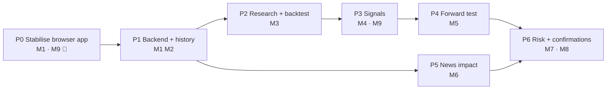

# Roadmap: from live dashboard to trade confirmations

Module specs live in `docs/product/modules/`. Each phase ends with something **measurable**.
Tick boxes as work lands; delete finished phases' detail once they're summarised in `STATUS.md`.

## Phase 0 · Stabilise the browser app (current)

- [x] Fix the runtime crash (`CANDLE_INTERVALS` / `setActiveInterval` undefined in `MainContainer`)
- [x] Fix the remaining type errors (missing imports in `AlertService`/`AlertEngine`,
      `CandleService.fetchCandles` in `ChartPanel`)
- [x] Delete dead files and the unused `@electric-sql/pglite` dependency
- [x] Backend prototype starts (`npm run backend` bundles it) and passes type-check + lint
- [x] Test runner: Vitest via Vite+, 191 tests (master, 2026-10-25)
- [x] CI: GitHub Action (`.github/workflows/ci.yml`) runs check, tests, build and the backend bundle on each PR
- [x] Fix symbol filter dropping JUP/SUPER etc. (`toCanonicalSymbols` in `symbolUtils`)
- [x] Unsubscribe price/funding streams on symbol removal (all three adapters)
- [x] Exchange badge shows `down` after 3 failed reconnects in a row (`utils/connectionState`)
- [x] Label Delta instruments as USD; never mix with USDT silently (spread panel compares USDT only)
- [ ] Verify Delta funding-rate units against the docs (tagged "units unverified" until then)

**Exit:** app loads with no errors; `npm run build` and CI green; STATUS issues 1–5 closed.

> The old module roadmap from `agent-docs/projectNotes.txt` (Modules 0–11) is folded in here:
> 0–6 ≈ done (see STATUS); 7 Telegram → P6 alerts; 8 history/replay → P1 + P2; 9 liquidity
> heatmap and 10 derivatives stats → Parking lot / P2 features; 11 reliability → every phase's exit.

## Phase 1a · Dashboard + Chart workspace in the browser ✅ (2026-11-01)

- [x] Analysis engine in `src/utils/`: volume profile, zones, double bottom / bullish engulfing /
      hammer, outcome resolution, setup statistics with Wilson range and break-even verdict
- [x] `HistoryService` (Binance public REST) + multi-coin scan
- [x] Dashboard (setup scanner, setup performance table, pipeline, watchlist)
- [x] Chart workspace (Lightweight Charts, overlays, setup card, volume levels, zones)
- [x] Pattern stats, Risk calculator, Alerts screens (designs in `docs/product/ux/reference/`)
- [ ] More detectors

## Phase 1 · Backend + history (M1, M2)

- [x] Decide backend stack: Python 3.12 + FastAPI + QuestDB (see DECISIONS, ARCHITECTURE)
- [ ] Monorepo layout per `ARCHITECTURE.md`: move frontend to `apps/web`, scaffold `backend/` with uv
- [ ] Collector service: Binance + OKX (+ Delta) via CCXT; health + gap detection
- [ ] `infra/docker-compose.yml`: QuestDB + backend + web
- [ ] QuestDB tables: candles 1m, funding, OI
- [ ] Backfill job: 2 years of the top 20 USDT pairs
- [ ] Data quality report (gaps, dupes, outliers)
- [ ] Detectors (deterministic, versioned, unit-tested): candlestick and chart patterns,
      demand/supply zones, volume profile (POC, VAH/VAL, HVN/LVN)
- [ ] Setup history engine: pattern × location → outcome (target before stop), n, win rate,
      Wilson 95% range, avg win/loss, gross expectancy; per coin and pooled across 20 coins
- [ ] API: `/candles`, `/indicators`, `/patterns`, `/zones`, `/volume-profile`, `/scanner/now`,
      `/setups`, `/setups/{id}/history`, `/alerts`, `/coverage`, `/quality`, `/backfill`, `/health`
- [ ] Phase 1 UI per `docs/product/ux/PHASE1_UX.md`, in priority order: **Dashboard** (setup
      scanner), **Chart workspace** (Lightweight Charts + indicators, patterns, zones, volume
      levels, setup card), Pattern stats, Risk calculator, Alerts, Research data
- [ ] Server-side setup alerts + Telegram delivery (port from `src/backend/telegramService.ts`)

**Exit:** 7 days of unattended collection; < 0.1 % gaps after backfill; Phase 1 UI acceptance
criteria met.

## Phase 2 · Research + backtest (M3)

- [ ] Feature library (TA, funding percentile, basis, OI change, regime)
- [ ] Vectorised screener + event-driven backtester with the shared cost model
- [ ] Strategy report generator (HTML) + gate checker
- [ ] Research journal: every hypothesis and result logged, including failures
- [ ] First 3 hypotheses tested (funding extremes, breakout+vol, basis reversion)

**Exit:** ≥ 1 strategy passes the gate in `M3-research-backtest.md`.

## Phase 3 · Signal engine (M4) + UI

- [ ] Strategy runtime shared with the backtester (parity test)
- [ ] Signals table + API; Strategies and Confirmations screens (paper only)
- [ ] Upgrade the spread panel to fee- and USD/USDT-aware basis/spread calculations
- [ ] Add TanStack Query for API data on the new screens (plain `fetch` until then)

**Exit:** live signals match replayed backtest entries 1:1.

## Phase 4 · Forward test (M5)

- [ ] Paper ledger for every signal and veto; drift detection + auto-pause

**Exit:** ≥ 30 forward trades per promoted strategy inside the backtest 95 % band.

## Phase 5 · News impact (M6), can run in parallel after P1

- [ ] Ingest news + calendar + exchange announcements; classify
- [ ] Event-study per category; impact rules

**Exit:** measured improvement (or none) of news filtering, documented.

## Phase 6 · Risk + confirmations (M7, M8)

- [ ] Risk manager with all veto paths unit-tested
- [ ] Calibrated confidence + confirmation cards + alerts (Telegram)
- [ ] Monthly calibration report

**Exit:** confirmations live; calibration within ± 5 %.

## Parking lot (ideas, not scheduled)

- Order-book features for research: full depth needs snapshot + diff sync (today: top-20 partial book).
- Liquidity heatmap (old Module 9); candidate renderer: nazmiefearmutcu/flowmap (see TOOLING).
- Derivatives stats: OI, basis, liquidations, CVD, volume profile (old Module 10).
- Chart drawing tools.
- Angel One / Indian equities (removed in `4350c71`).
- Auto-execution, only after Phase 4/6 evidence justifies it.
- Browser push notifications and quiet hours for setup alerts.
- ML models (gradient boosting on features) as a _filter_ on rule-based signals, never a black box.
