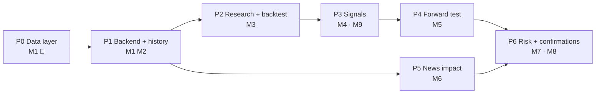

# Roadmap: from live dashboard to trade confirmations

Module specs live in `docs/product/modules/`. Each phase ends with something **measurable**.
Tick boxes as work lands; delete finished phases' detail once they're summarised in `STATUS.md`.

## Phase 0 · Finish the live data layer (current)
- [ ] Fix symbol filter dropping JUP/SUPER etc. (`SymbolService`)
- [ ] Unsubscribe on symbol removal (all three adapters)
- [ ] Stale/down detection via heartbeat → `stale`/`down` badge
- [ ] Label Delta instruments as USD; never mix with USDT silently
- [ ] Verify Delta funding-rate units against the docs
- [ ] Add a test runner (Vitest via Vite+) with adapter parsing tests on recorded fixtures
- [ ] CI: GitHub Action running build + lint + tests on each PR

**Exit:** `STATUS.md` known issues 1–5 closed; CI is green.

## Phase 1 · Backend + history (M1, M2)
- [x] Decide backend stack: Python 3.12 + FastAPI + QuestDB (see DECISIONS, ARCHITECTURE)
- [ ] Monorepo layout per `ARCHITECTURE.md`: move frontend to `apps/web`, scaffold `backend/` with uv
- [ ] Collector service: Binance + OKX (+ Delta) via CCXT; health + gap detection
- [ ] `infra/docker-compose.yml`: QuestDB + backend + web
- [ ] QuestDB tables: candles 1m, funding, OI
- [ ] Backfill job: 2 years of the top 20 USDT pairs
- [ ] Data quality report (gaps, dupes, outliers)
- [ ] API: `/candles`, `/funding`, `/health`; UI reads health from the API

**Exit:** 7 days of unattended collection; < 0.1 % gaps after backfill.

## Phase 2 · Research + backtest (M3)
- [ ] Feature library (TA, funding percentile, basis, OI change, regime)
- [ ] Vectorised screener + event-driven backtester with the shared cost model
- [ ] Strategy report generator (HTML) + gate checker
- [ ] Research journal: every hypothesis and result logged, including failures
- [ ] First 3 hypotheses tested (funding extremes, breakout+vol, basis reversion)

**Exit:** ≥ 1 strategy passes the gate in `M3-research-backtest.md`.

## Phase 3 · Signal engine (M4) + UI
- [ ] Strategy runtime shared with the backtester (parity test)
- [ ] Signals table + API; Strategies and Confirmations screens (paper only)
- [ ] Re-introduce a spread/basis view, fed by real calculations

**Exit:** live signals match replayed backtest entries 1:1.

## Phase 4 · Forward test (M5)
- [ ] Paper ledger for every signal and veto; drift detection + auto-pause

**Exit:** ≥ 30 forward trades per promoted strategy inside the backtest 95 % band.

## Phase 5 · News impact (M6), can run in parallel after P1
- [ ] Ingest news + calendar + exchange announcements; classify
- [ ] Event-study per category; impact rules

**Exit:** measured improvement (or none) of news filtering, documented.

## Phase 6 · Risk + confirmations (M7, M8)
- [ ] Risk manager with all veto paths unit-tested
- [ ] Calibrated confidence + confirmation cards + alerts (Telegram)
- [ ] Monthly calibration report

**Exit:** confirmations live; calibration within ± 5 %.

## Parking lot (ideas, not scheduled)
- Order-book depth features (needs snapshot + diff handling).
- Angel One / Indian equities (removed in `4350c71`).
- Auto-execution, only after Phase 4/6 evidence justifies it.
- ML models (gradient boosting on features) as a *filter* on rule-based signals, never a black box.
