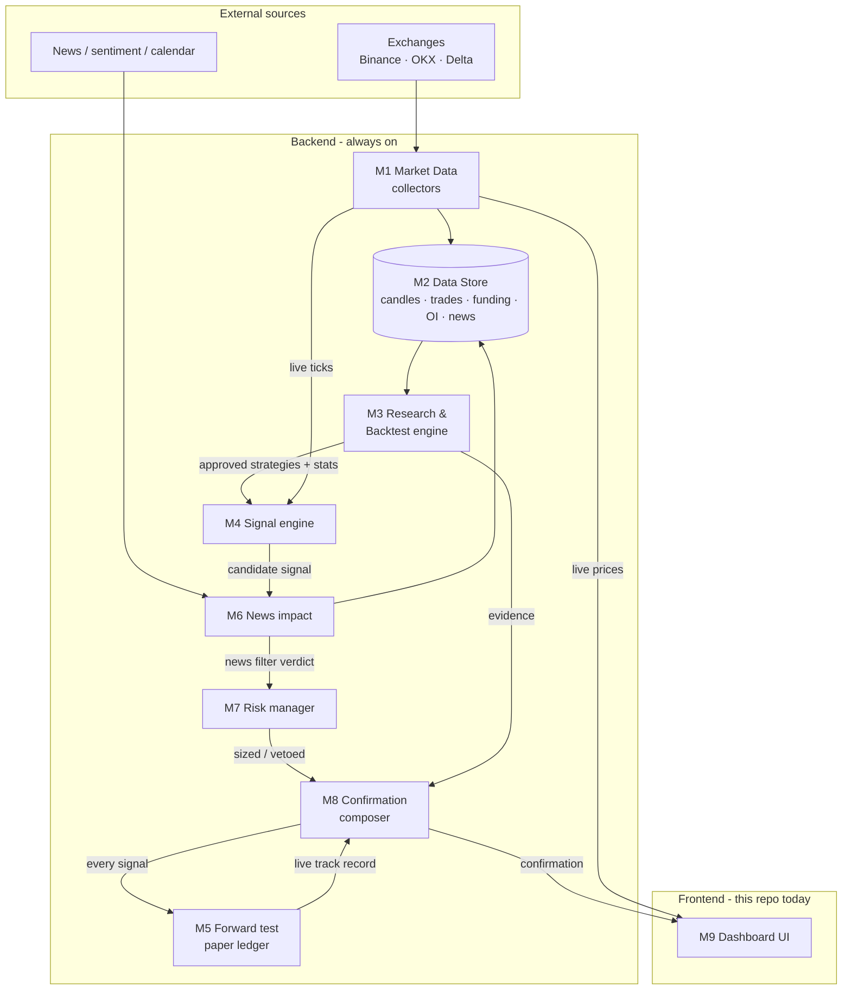
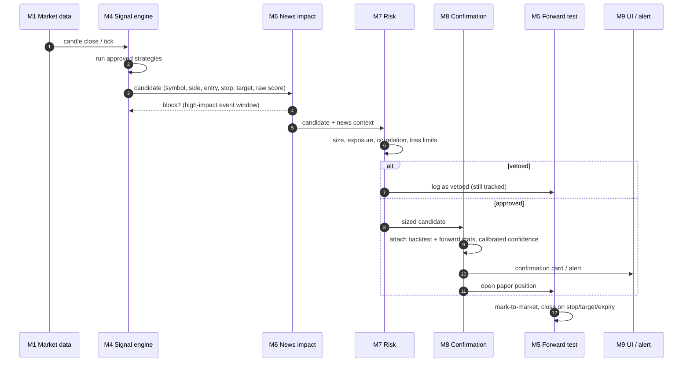

# Product overview

## What we're building

A **trade confirmation system**: it watches crypto markets, and only when a setup with a
_proven, measured edge_ appears does it issue a confirmation. Each confirmation carries the
entry, stop, target, size, and the evidence behind it: backtest stats, forward-test record,
news check and risk check.

It is **not** a signal-spam bot. Silence is the default output. A confirmation must be earned.

## Product principles

1. **Evidence over opinion.** No strategy goes live without a backtest report _and_ a forward-test
   record that agrees with it.
2. **Costs are real.** Fees, slippage, funding and spread are in every number we show.
3. **Calibrated confidence.** "80 % confidence" must mean ~80 % of such calls historically
   worked, measured on out-of-sample data, never on in-sample fit.
4. **Risk first.** Risk management can veto any signal; nothing can override the risk module.
5. **Explainable.** Every confirmation shows _why_, in plain language, with links to the data.
6. **Human in the loop.** The system confirms; the trader executes (auto-execution is out of
   scope until Phase 4 results justify it).

## Target architecture

## Life of a confirmation

## Modules

| #   | Module                | Status                                                           | Spec                                                               |
| --- | --------------------- | ---------------------------------------------------------------- | ------------------------------------------------------------------ |
| M1  | Market data           | 🚧 browser-only; prices, funding, candles, order book            | [modules/M1-market-data.md](modules/M1-market-data.md)             |
| M2  | Data store & history  | ⬜                                                               | [modules/M2-data-store.md](modules/M2-data-store.md)               |
| M3  | Research & backtest   | ⬜                                                               | [modules/M3-research-backtest.md](modules/M3-research-backtest.md) |
| M4  | Signal engine         | ⬜                                                               | [modules/M4-signal-engine.md](modules/M4-signal-engine.md)         |
| M5  | Forward test          | ⬜                                                               | [modules/M5-forward-test.md](modules/M5-forward-test.md)           |
| M6  | News impact           | ⬜                                                               | [modules/M6-news-impact.md](modules/M6-news-impact.md)             |
| M7  | Risk manager          | ⬜                                                               | [modules/M7-risk.md](modules/M7-risk.md)                           |
| M8  | Confirmation composer | ⬜                                                               | [modules/M8-confirmation.md](modules/M8-confirmation.md)           |
| M9  | Dashboard UI          | 🚧 prices, charts, order book, alerts; currently crashes on load | [modules/M9-ui.md](modules/M9-ui.md)                               |

Delivery order and milestones: [`../context/ROADMAP.md`](../context/ROADMAP.md).
Recommended libraries and tools: [`../context/TOOLING.md`](../context/TOOLING.md).

## Glossary

- **Edge**: positive expectancy after costs, i.e. `win% × avg win − loss% × avg loss − costs > 0`.
- **Expectancy (R)**: average result per trade in units of initial risk (1R = entry→stop distance).
- **Out-of-sample (OOS)**: data the strategy was never tuned on.
- **Walk-forward**: repeatedly tune on window _t_, test on _t+1_, roll forward.
- **Funding rate**: periodic payment between perp longs and shorts; positive means longs pay.
- **Basis**: futures price − spot price.
