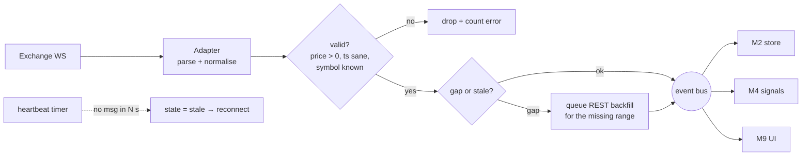

# M1 · Market data

**Status:** 🚧 Works in the browser (`src/adapters`, `src/services`): prices, funding, candles with
REST backfill, Binance top-20 order book and trade prints, 24 h stats. Must move to an always-on
backend collector in Phase 1, because a browser tab can't record history or run signals 24/7.

## Responsibilities
- Hold WebSocket connections to every exchange; normalise to canonical symbols (`BTC-USDT`).
- Stream trades, candles, funding, mark price, open interest and top-of-book.
- Detect gaps and staleness and report health per exchange × stream.
- Fan out to subscribers: the data store (M2), the signal engine (M4) and the UI (M9).

## Flow

## Normalised events
| Event | Fields |
| --- | --- |
| `trade` | exchange, symbol, market(SPOT/FUT), price, qty, side, ts_ms |
| `candle` | exchange, symbol, market, interval, o, h, l, c, v, ts_open_ms, closed |
| `funding` | exchange, symbol, rate_pct, next_ts_ms, interval_s, predicted_rate_pct? |
| `oi` | exchange, symbol, open_interest, ts_ms |
| `health` | exchange, stream, state(connecting/live/stale/down), last_msg_ts |

## Acceptance criteria
- [ ] Phase-0 known issues fixed (see `docs/context/STATUS.md`).
- [ ] Stale stream detected within 30 s; state shows `stale`/`down`, not "Connecting…" forever.
- [ ] Removing a symbol unsubscribes it.
- [ ] Delta USD instruments labelled USD and never silently mixed with USDT.
- [ ] Backend collector runs 7 days without manual restart; gaps are backfilled.

## Open questions
- Use the official **CCXT** library (100+ exchanges, unified REST and WS) in the backend, or keep
  hand-written adapters? Proposed: CCXT for REST and backfill, hand-written WS where latency or
  fields matter.
