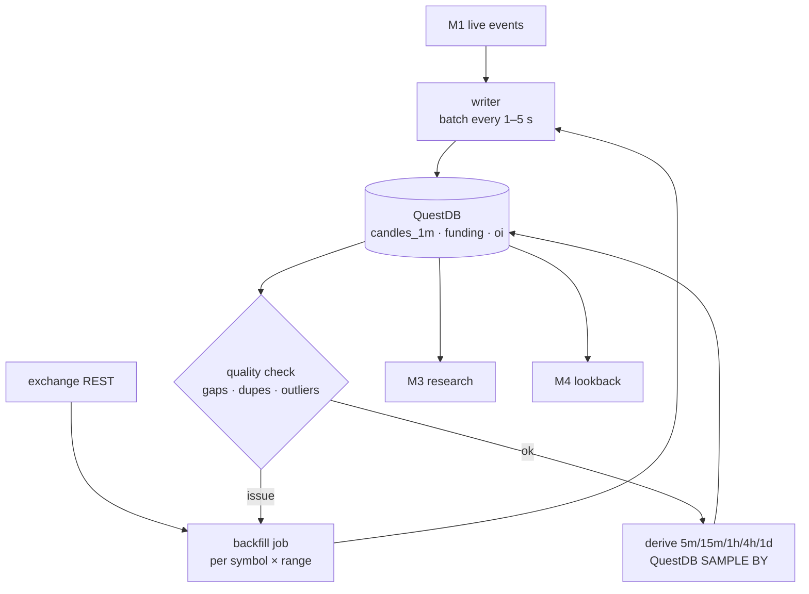

# M2 · Data store & history

**Status:** ⬜ Not started. Nothing is persisted today.

## Responsibilities

- Persist candles (1m base, higher timeframes derived), funding history, open interest, sampled
  trades, news events, signals and paper trades.
- Backfill history from exchange REST APIs; detect and repair gaps.
- Serve fast range queries to research (M3) and live lookbacks to the signal engine (M4).

## Flow

## Storage choice

Decided 2026-11-01 (see `docs/context/DECISIONS.md`, `ARCHITECTURE.md`): **QuestDB only**.

- Ingest via the official Python client (InfluxDB Line Protocol); query over the Postgres wire
  protocol (`psycopg`). Use `SAMPLE BY` for higher timeframes, `LATEST ON` for current state and
  `ASOF JOIN` for spot↔perp / cross-exchange alignment.
- App data (signals, paper trades) is **append-only events**; PostgreSQL deferred until proven needed.
- DuckDB + Polars optional, locally, for heavy research over Parquet exports.

## Core tables (all QuestDB)

| Table           | Key                                         | Columns                                                                                                      |
| --------------- | ------------------------------------------- | ------------------------------------------------------------------------------------------------------------ |
| `candles`       | exchange, symbol, market, interval, ts_open | o, h, l, c, v, trades                                                                                        |
| `funding`       | exchange, symbol, ts                        | rate_pct, interval_s                                                                                         |
| `open_interest` | exchange, symbol, ts                        | oi, oi_usd                                                                                                   |
| `news_events`   | id                                          | ts, source, title, symbol (one row per symbol tagged), category, impact_score                                |
| `signal_events` | signal_id, ts                               | event (created/vetoed/confirmed/expired), strategy_version, symbol, side, entry, stop, target, score, reason |
| `trade_events`  | trade_id, ts                                | event (opened/marked/closed), signal_id, price, qty, pnl_r, fees, reason                                     |

## Acceptance criteria

- [ ] 2+ years of 1m candles for the top 20 USDT pairs (Binance and OKX), with funding history.
- [ ] Gap report shows < 0.1 % missing minutes after backfill.
- [ ] A 1-year 1m scan for one symbol returns in under 1 s.
