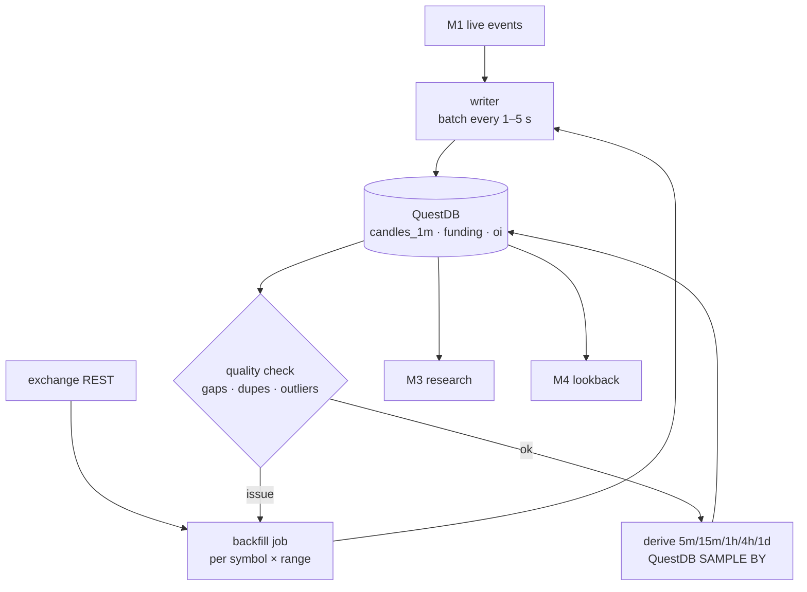

# M2 · Data store & history

**Status:** ⬜ Not started. Nothing is persisted today.

## Responsibilities
- Persist candles (1m base, higher timeframes derived), funding history, open interest, sampled
  trades, news events, signals and paper trades.
- Backfill history from exchange REST APIs; detect and repair gaps.
- Serve fast range queries to research (M3) and live lookbacks to the signal engine (M4).

## Flow

## Storage choice (proposed)
Decided (see `docs/context/DECISIONS.md`):
- **QuestDB** for market data: `candles`, `funding`, `open_interest`, `news_events`.
  Ingest via the official Python client (InfluxDB Line Protocol); query over the Postgres wire
  protocol (`psycopg`). Use `SAMPLE BY` for higher timeframes, `LATEST ON` for last values and
  `ASOF JOIN` for spot↔perp / cross-exchange alignment.
- **PostgreSQL** for app data: `signals`, `paper_trades`, risk state, config.
- **DuckDB + Polars** locally for heavy research over Parquet exports.
- Both databases run in Docker Compose.

## Core tables (QuestDB: first four · PostgreSQL: last two)
| Table | Key | Columns |
| --- | --- | --- |
| `candles` | exchange, symbol, market, interval, ts_open | o, h, l, c, v, trades |
| `funding` | exchange, symbol, ts | rate_pct, interval_s |
| `open_interest` | exchange, symbol, ts | oi, oi_usd |
| `news_events` | id | ts, source, title, symbols[], category, impact_score |
| `signals` | id | ts, strategy, symbol, side, entry, stop, target, score, status |
| `paper_trades` | id | signal_id, open_ts, close_ts, entry, exit, pnl_r, fees, reason |

## Acceptance criteria
- [ ] 2+ years of 1m candles for the top 20 USDT pairs (Binance and OKX), with funding history.
- [ ] Gap report shows < 0.1 % missing minutes after backfill.
- [ ] A 1-year 1m scan for one symbol returns in under 1 s.
