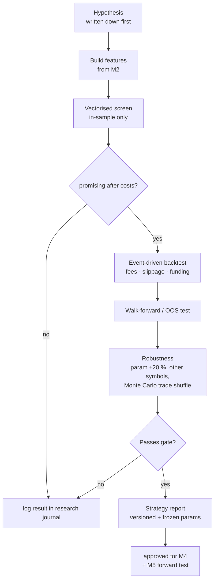

# M3 · Research & backtest engine

**Status:** ⬜ Not started. This module decides what "edge" means for the whole product.

## Responsibilities
- Feature/indicator library: TA (trend, momentum, volatility), funding, basis, OI change, volume
  profile, regime labels.
- **Fast screening** (vectorised) to explore many ideas cheaply.
- **Realistic validation** (event-driven) with fees, slippage, funding, latency and partial fills.
- Statistical gate that a strategy must pass before M4 may run it.

## Research pipeline

## The gate (initial thresholds, tune later)
| Metric (out-of-sample, after costs) | Minimum |
| --- | --- |
| Trades | ≥ 100 |
| Expectancy | > 0.15 R |
| Profit factor | > 1.3 |
| Max drawdown | < 20 % at the proposed risk per trade |
| Walk-forward windows profitable | ≥ 60 % |
| Param sensitivity (±20 %) | still profitable |
| Deflated Sharpe / multiple-testing check | p < 0.05 |

## Strategy report contents
Equity curve, drawdown curve, trade list, monthly returns, stats table (win %, avg win/loss,
expectancy, PF, Sharpe, Sortino, Calmar, MAR), performance by regime and symbol, cost breakdown,
and the frozen parameter set with a git hash.

## Acceptance criteria
- [ ] Same strategy code runs in backtest (M3), paper (M5) and live signals (M4), with no rewrites.
- [ ] A backtest of a known strategy matches a hand calculation on a small fixture dataset (test).
- [ ] Every report is reproducible from (data snapshot, params, code hash).
