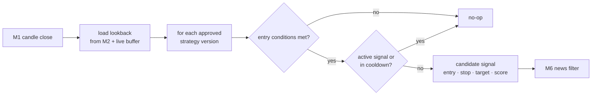

# M4 · Signal engine

**Status:** ⬜ Not started.

## Responsibilities

- Run only **gate-approved** strategy versions from M3 on live data.
- Produce candidate signals: symbol, side, entry, stop, target(s), expiry, raw score, strategy id.
- Deduplicate and cool down (one active signal per strategy × symbol).

## Flow

## Starter strategy candidates (each must pass M3 first)

| Idea                               | Edge hypothesis                                        | Data needed               |
| ---------------------------------- | ------------------------------------------------------ | ------------------------- |
| Funding-rate extremes              | Crowded positioning mean-reverts after extreme funding | funding, OI, price        |
| Funding carry                      | Collect funding with a delta-neutral spot/perp pair    | funding, spot, perp, fees |
| Cross-exchange basis               | Perp/spot or exchange/exchange spread mean-reverts     | multi-exchange prices     |
| Trend breakout + volatility filter | Breakouts in expanding vol trend more often than not   | candles, ATR              |
| Mean reversion in range regime     | Range regime + RSI extremes revert                     | candles, regime label     |

## Acceptance criteria

- [ ] Live signals on replayed historical data are identical to the backtest's entries (parity test).
- [ ] Signal latency from candle close to candidate < 2 s.
