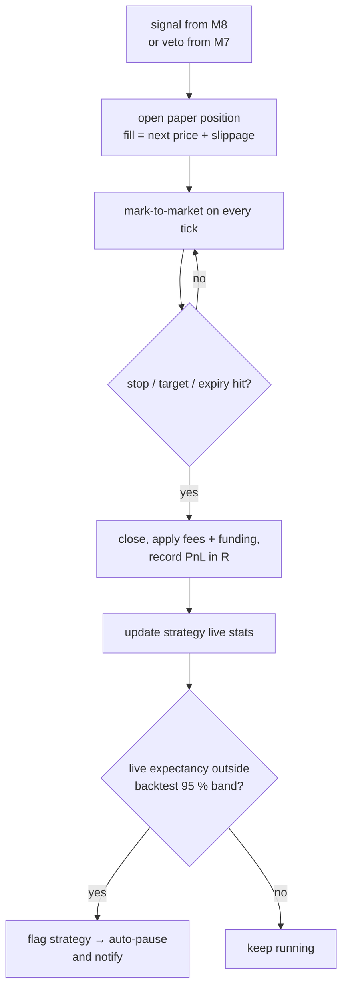

# M5 · Forward test (paper ledger)

**Status:** ⬜ Not started.

## Responsibilities

- Open a paper position for **every** signal, including vetoed ones (tracked separately), so we
  can measure the veto's value too.
- Simulate fills with the same cost model as M3; close on stop, target or expiry.
- Compare live results to the backtest's expected distribution and flag drift.

## Flow

## Promotion rule

A strategy may show **confirmations** (not just paper signals) only after its forward test reaches
≥ 30 trades with expectancy inside the backtest's 95 % confidence band.

## Acceptance criteria

- [ ] Every signal has exactly one paper trade record.
- [ ] Drift detection auto-pauses a strategy and the UI shows why.
