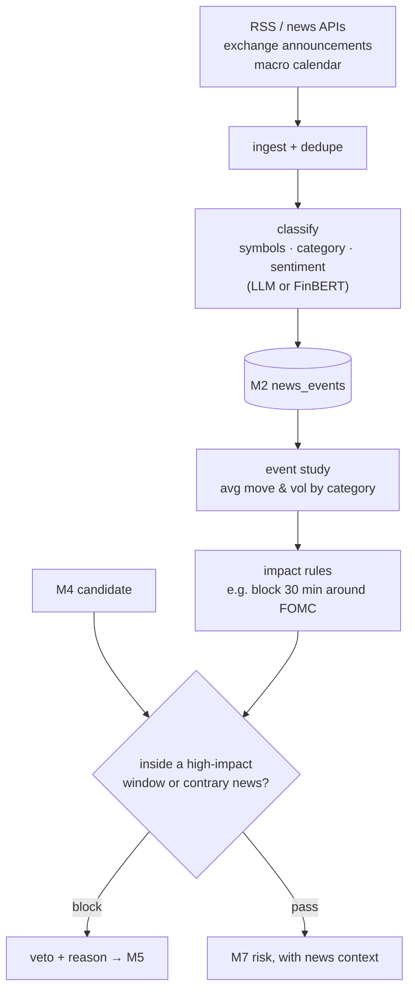

# M6 · News impact

**Status:** ⬜ Not started.

## Responsibilities

- Ingest crypto news, exchange announcements (listings, delistings, maintenance), the macro
  calendar (CPI, FOMC, NFP) and token unlocks.
- Classify each item by symbols, category and sentiment, and estimate impact.
- **Measure** historical impact (price and volatility move after similar events) before using a
  category as a filter.
- Act as a filter: block or flag signals in high-impact windows; add context to confirmations.

## Flow

## Acceptance criteria

- [ ] The event-study table exists for each category before that category may block a signal.
- [ ] Every block reason is visible on the vetoed signal.
- [ ] Forward test (M5) shows whether news filtering improved expectancy, measured rather than assumed.

## Open questions

- Which sources (free tiers vary)? CryptoPanic, exchange RSS/announcement pages, a public
  economic calendar. Decide in Phase 5.
