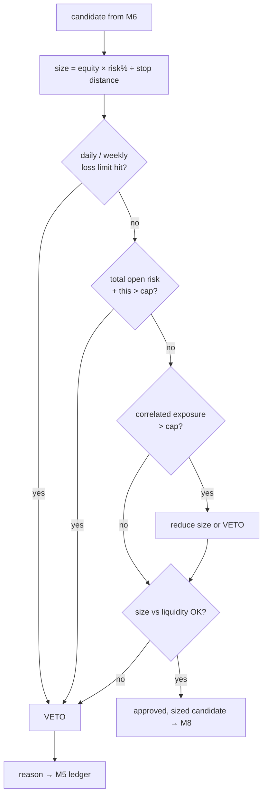

# M7 · Risk manager

**Status:** ⬜ Not started. It has the final say: it can veto anything and nothing overrides it.

## Responsibilities
- Position sizing from account equity and stop distance.
- Portfolio limits: total open risk, per-symbol and per-direction exposure, correlation clusters.
- Circuit breakers: daily/weekly loss limits, consecutive-loss pause, kill switch.
- Liquidity sanity: position size relative to book depth and 24 h volume.

## Flow

## Default limits (configurable)
| Rule | Default |
| --- | --- |
| Risk per trade | 0.5–1 % of equity |
| Total open risk | 3 % |
| Max correlated cluster risk | 2 % (e.g. BTC + ETH long counts as one cluster) |
| Daily loss limit | 3 % → no new confirmations until next day |
| Consecutive losses | 5 → pause 24 h |
| Size cap | ≤ 1 % of the symbol's 1-min average volume |

Sizing beyond fixed-fractional, such as capped fractional Kelly, is allowed only for strategies
with ≥ 200 OOS trades.

## Acceptance criteria
- [ ] Unit tests cover every veto path.
- [ ] No code path creates a confirmation without passing M7.
