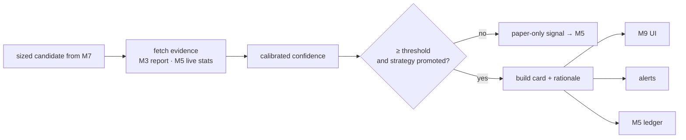

# M8 · Confirmation composer

**Status:** ⬜ Not started. This is the product's output.

## Responsibilities

- Turn an approved, sized candidate into a **confirmation card** with calibrated confidence and
  a plain-language rationale.
- Deliver it to the UI and, optionally, to alerts (Telegram or push).

## Calibrated confidence

Confidence is a _measured probability_, not a vibe:

```
p̂  = OOS win rate of this strategy version in the current regime
CI = Wilson 95 % interval on p̂ given n trades
confidence = lower bound of CI, then × forward-test agreement factor (0–1)
```

A setup is shown as a confirmation only when `confidence ≥ threshold` **and** expectancy > 0.
Otherwise it stays a paper signal.

## Flow



## Confirmation card

| Field                  | Example                                                    |
| ---------------------- | ---------------------------------------------------------- |
| Setup                  | BTC-USDT · LONG · Funding-extreme reversal v1.3            |
| Entry / Stop / Targets | 64 200 / 63 400 / 65 800, 66 600                           |
| Size                   | 0.12 BTC (0.75 % risk)                                     |
| Confidence             | 63 % (OOS n = 214, forward n = 41)                         |
| Expectancy             | +0.31 R after costs                                        |
| Why                    | Funding at 99th percentile, OI falling, price at range low |
| Risks / news           | FOMC in 6 h; correlated ETH long open                      |
| Expires                | 4 h                                                        |

## Acceptance criteria

- [ ] Every card links to its backtest report and forward-test record.
- [ ] Monthly calibration plot: predicted confidence vs realised win rate, on the diagonal ± 5 %.
