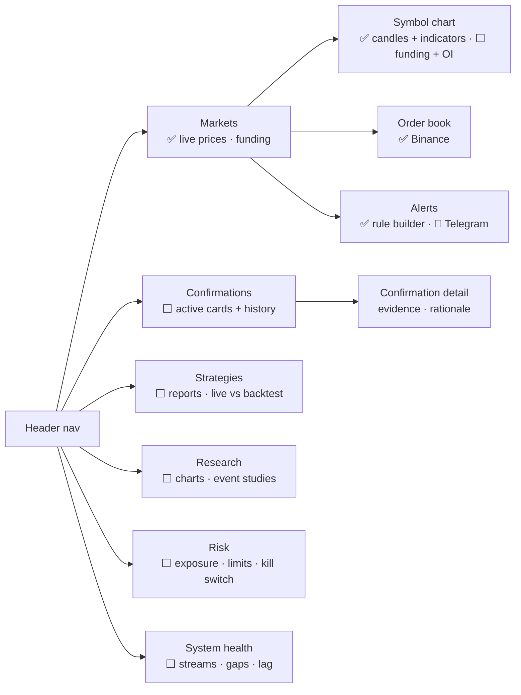

# M9 · Dashboard UI

**Status:** 🚧 Phase 1a built: Dashboard (setup scanner) and Chart workspace (`src/components/
DashboardPage`, `ChartPage`), plus the older Markets page. Pattern stats, Risk, Alerts, Data,
and later confirmation screens are planned.

## Screens

## Phase 1 UX

Dashboard (setup scanner) and chart workspace first (indicators, pattern detection, zones,
volume levels, setup history), plus the visual language (first canvas's terminal style with
modern detailing) are in
[`../ux/PHASE1_UX.md`](../ux/PHASE1_UX.md), with a clickable prototype in
[`../ux/phase1-prototype.html`](../ux/phase1-prototype.html).

## Rules
- The frontend reads from the backend API once Phase 1 lands. Direct exchange sockets in the
  browser stay for the Markets screen only, or are dropped.
- Charts: TradingView **lightweight-charts** for price; one charting library for stats.
- Never show a number that isn't backed by data, and label observations vs estimates.

## Acceptance criteria
- [ ] Confirmations screen shows card, evidence links and status (active/hit/stopped/expired).
- [ ] System health screen shows per-stream state and last message age.
