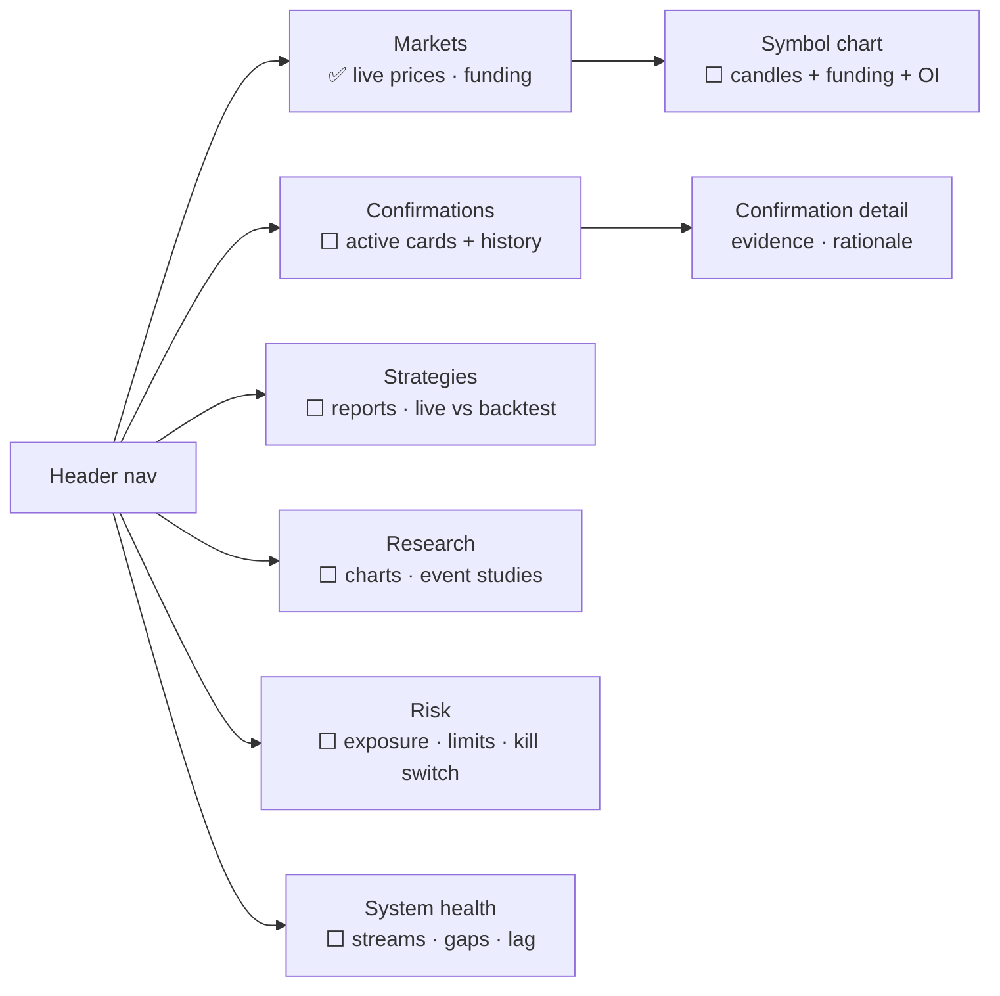

# M9 · Dashboard UI

**Status:** 🚧 Live price/funding table exists (this repo, React 19 + Vite+). Everything else is planned.

## Screens

## Rules
- The frontend reads from the backend API once Phase 1 lands. Direct exchange sockets in the
  browser stay for the Markets screen only, or are dropped.
- Charts: TradingView **lightweight-charts** for price; one charting library for stats.
- Never show a number that isn't backed by data (see the arbitrage-panel removal in DECISIONS).

## Acceptance criteria
- [ ] Confirmations screen shows card, evidence links and status (active/hit/stopped/expired).
- [ ] System health screen shows per-stream state and last message age.
