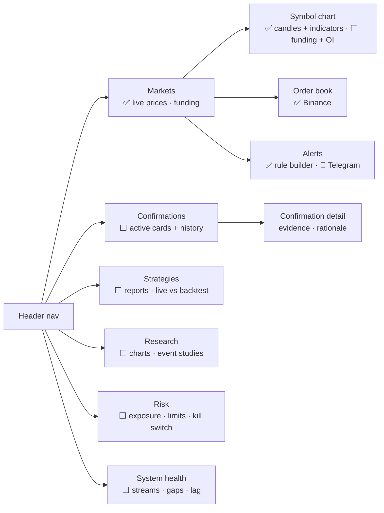

# M9 · Dashboard UI

**Status:** 🚧 One dashboard page with re-orderable panels: price table, chart + indicators,
order book, spread panel, alert rule builder. **Crashes on load right now** (see STATUS).
Screens for confirmations, strategies, risk and health are planned.

## Screens

## Phase 1 UX

Confirmation-desk shell, evidence-first screens, rules and the visual language (the first
canvas's terminal style; subtle glass and parallax) are in
[`../ux/PHASE1_UX.md`](../ux/PHASE1_UX.md), with a clickable prototype in
[`../ux/phase1-prototype.html`](../ux/phase1-prototype.html).

## Rules
- The frontend reads from the backend API once Phase 1 lands. Direct exchange sockets in the
  browser stay for the Markets screen only, or are dropped.
- Charts: TradingView **lightweight-charts** for price; one charting library for stats.
- Never show a number that isn't backed by data, and label observations vs estimates.

## Acceptance criteria
- [ ] Confirmations screen shows card, evidence links and status (active/hit/stopped/expired).
- [ ] System health screen shows per-stream state and last message age.
