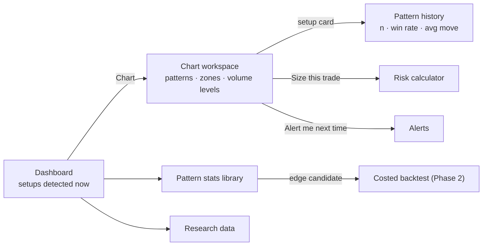

# Phase 1 UX: setup scanner and chart workspace

**Prototype:** [`phase1-prototype.html`](phase1-prototype.html). Open it in a browser; it is
self-contained and uses sample data. Every screen, the chart layer toggles, the pattern
switcher, search (Ctrl/⌘ K), the explainer drawer, the risk calculator and alert previews work.

**Reference designs:** [`reference/`](reference/README.md) holds images of the next planned
screens (Pattern stats, Risk calculator, Alerts), rendered from the design canvas where the owner
adds ideas. Build against those images; update them when the canvas changes.

## What the owner wants first

1. **Dashboard**: what is setting up right now, and how did that setup do before.
2. **TradingView-style chart** with indicators, **automatic chart-pattern detection**,
   **demand/supply zones** and **key volume levels**.
3. **Pattern history** for every detected setup: "this occurred N times, moved X%, won Y% of the
   time".
4. The core idea: _a bullish pattern forming inside a demand zone has a high chance of winning,
   with confidence from backtested data._ The UI measures exactly that, honestly.

## Honesty rules for pattern statistics

- A setup is **pattern + location** (e.g. double bottom _in a demand zone_, bull flag _above the
  point of control_). Each combination is measured separately, because location changes results
  (sample: double bottom in a demand zone 61%, in open space 49%).
- **Win** = target hit before stop. Target is the measured move or the next opposing zone; stop
  sits beyond the pattern. Rules are fixed in code before anything is measured.
- Every win rate shows **n** and a **95% Wilson range**. Example: 4 of 5 on one coin is 80%, but
  the true rate could be 38–96%. So the panel shows **this coin** and **the same setup across 20
  coins** (e.g. 129 of 212 = 61%, range 54–67%). Only the pooled number can support confidence.
- Verdicts: **edge candidate** (range entirely above 50%), **no edge**, or **too few** (under 30).
- Phase 1 numbers are **gross** (before fees). Phase 2 re-tests edge candidates with fees,
  slippage and out-of-sample data before anything can become a confirmation.

## Screens

| Screen            | What it shows                                                                                                                                                                                                                                                                                                                                                                     | Backend it needs                                                                                      |
| ----------------- | --------------------------------------------------------------------------------------------------------------------------------------------------------------------------------------------------------------------------------------------------------------------------------------------------------------------------------------------------------------------------------- | ----------------------------------------------------------------------------------------------------- |
| **Dashboard**     | Scanner headline + KPIs; **setups detected now** (symbol, TF, setup, past n, win rate with range, avg move, verdict, open chart); pipeline from pattern to confirmation; watchlist cards                                                                                                                                                                                          | `/scanner/now`, `/prices` (WS), `/pipeline`                                                           |
| **Chart**         | Candles + volume; toggles for EMA 50, Bollinger, zones, volume profile, pattern; detected pattern drawn on the chart with entry/stop/target; side panel: patterns on this chart, **setup card** (win rate across 20 coins and this coin, avg move, expectancy, confluence checklist, last 5 occurrences); key volume levels (POC, VAH, VAL, HVN, LVN); zones with tests and holds | `/candles`, `/indicators`, `/patterns?symbol&tf`, `/zones`, `/volume-profile`, `/setups/{id}/history` |
| **Pattern stats** | Library of every pattern × location: n, win rate, range, avg win/loss, gross expectancy, verdict; how a setup becomes a confirmation; guards against overfitting                                                                                                                                                                                                                  | `/setups`                                                                                             |
| **Risk**          | Position-size calculator pre-filled from the selected setup                                                                                                                                                                                                                                                                                                                       | none (pure maths)                                                                                     |
| **Alerts**        | "Tell me when [coin] prints a [setup] on [TF]" with the setup's record shown before saving; Telegram delivery                                                                                                                                                                                                                                                                     | `/alerts`, Telegram worker                                                                            |
| **Data**          | Coverage, quality checks, backfill queue                                                                                                                                                                                                                                                                                                                                          | `/coverage`, `/quality`, `/backfill`                                                                  |

## Screen flow

## Detection scope for Phase 1

| Group          | Items                                                                                                                        |
| -------------- | ---------------------------------------------------------------------------------------------------------------------------- |
| Candlestick    | Bullish/bearish engulfing, hammer, shooting star, morning/evening star                                                       |
| Chart patterns | Double bottom/top, inverse/head & shoulders, bull/bear flag, triangle breakouts                                              |
| Locations      | Demand/supply zones (origin of a fast move on high volume, with test count), POC, value-area high/low, high/low-volume nodes |
| Indicators     | EMA, SMA, RSI, MACD, VWAP, Bollinger, ATR (already in `src/utils/indicators.ts`)                                             |

Chart rendering uses TradingView **Lightweight Charts** (Apache-2.0, already a dependency), not
TradingView's paid Charting Library. Detection and statistics run server-side on stored candles.

## Visual language

The first canvas's terminal style (Inter + JetBrains Mono, `#0B0F14` ground, `#4C9AFF` accent,
solid bordered cards, pill badges, top navigation) with **modern detailing**:

- Gradient-edged **feature cards** (setups table, setup card) with a soft blue glow.
- Frosted **floating chart toolbar** and legend over the chart; frosted sticky top bar, search
  and explainer drawer.
- Hover lift on watchlist cards, gradient primary buttons, a faint ambient glow behind the page.
- **Parallax** only in the dashboard header band (contour field, dot grid, price trace), off under
  `prefers-reduced-motion`.

## Acceptance criteria (real implementation)

- [ ] Pattern and zone detectors are deterministic, unit-tested on fixture candles, and versioned.
- [ ] Setup history is computed server-side from stored candles; every number shows n and range.
- [ ] Setup card shows both the coin-only and the pooled result.
- [ ] Chart uses Lightweight Charts with overlays for zones, volume profile, pattern and plan.
- [ ] Contrast ≥ 4.5:1; parallax and transitions off under reduced motion; works at 400 px.
- [ ] Alerts fire server-side with the browser closed and arrive on Telegram.
