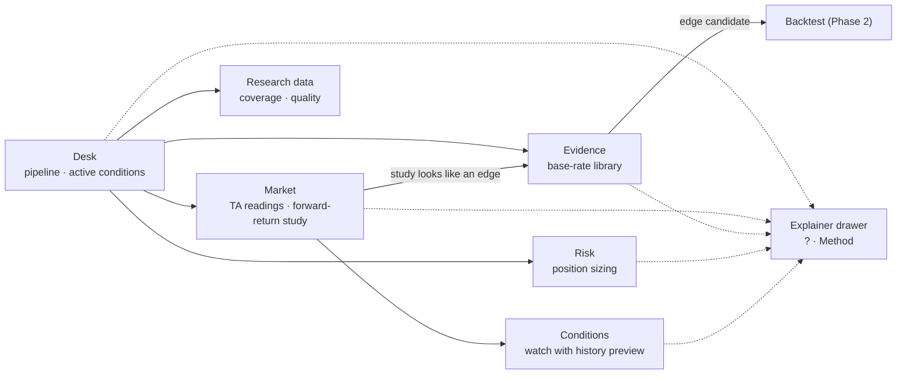

# Phase 1 UX: the evidence foundation

**Prototype:** [`phase1-prototype.html`](phase1-prototype.html). Open it in a browser; it is
self-contained and uses sample data. All six screens, symbol/study search (Ctrl/⌘ K), the
explainer drawer, the risk calculator and the condition preview work.

## Design thesis

The product exists to issue **high-confidence trade confirmations** backed by research,
backtesting, forward testing, measured edge, probability, TA, news and risk. Phase 1 can't issue
confirmations yet. It builds the data and statistics they will stand on. So the UI:

1. **Is organised around the confirmation from day one.** The home screen is the
   *Confirmation desk*: the full pipeline (Data → TA → Stats → Backtest → Forward → News → Risk →
   Confirmation), with what each stage does, its status, and the phase that unlocks it. "0
   confirmations" is shown honestly, with the path to the first one.
2. **Speaks in evidence, not opinion.** Every probability carries its sample size (n) and a 95%
   Wilson range. If the range crosses 50% the verdict is **no edge**. Indicator readings are
   ranked against two years of stored history (percentiles).
3. **Explains without dumbing down.** Real terms (base rate, percentile, R, expectancy,
   break-even win rate, regime) each have a "?" that opens a precise definition. The Method
   drawer explains how we avoid fooling ourselves (sample size, ranges, multiple testing).

## Screens and features

| Screen | What it does | Moto pillar | Backend it needs |
| --- | --- | --- | --- |
| **Desk** (home) | Pipeline status across all 8 stages; conditions active right now with probability, n, 95% range, verdict; path to first confirmation; regime per major | Confirmation, statistics | `/pipeline`, `/studies/active`, `/regime` |
| **Market** | Price with EMA 50 + Bollinger; indicator readings as 2-year percentiles; "When conditions looked like this, what happened next?" histogram of forward returns with n, P, range, median, 5th/95th percentile | TA, statistics | `/candles`, `/indicators`, `/studies/{id}/events` |
| **Evidence** | Base-rate study library with verdicts and next step (backtest in P2 or archive); "how a study becomes a confirmation"; guards against overfitting | Research, probability, mathematical edge | `/studies` |
| **Risk** | Position-size calculator from equity, risk %, entry, stop, target, fees and assumed win probability: size, money at risk, R:R, break-even win rate, expectancy, implied leverage; Phase 6 portfolio limits previewed | Risk management | none (pure maths); limits from config |
| **Conditions** | Sentence-style watch ("Notify me when SOL-USDT funding percentile is above 95"), **with its history shown before saving** (times it happened, P(outcome), range, verdict, low-n warning); Telegram delivery | Statistics, alerts | `/conditions` CRUD, `/studies/preview`, Telegram worker |
| **Research data** | Coverage per series, missing minutes, quality checks, backfill queue, feed status | Data (the foundation of backtests) | `/coverage`, `/quality`, `/backfill`, `/health` |

Later phases plug into the same shell: Backtest results (P2) feed the Evidence screen,
forward-test records (P4) and news windows (P5) light up their pipeline stages, and confirmation
cards (P6) take over the top of the Desk (see the earlier canvas for their layout).

## Screen flow

## Rules for every screen

1. Every probability shows **n** and a **95% range**; never a bare percentage.
2. A range that crosses 50% is labelled **no edge**. Below 30 events, warn "too few to trust".
3. Statistics are labelled **observations**; only the pipeline's last stage may say
   "confirmation".
4. Every number shows freshness or provenance (live age, stored range, study period).
5. Every term of art has a "?" with a precise definition; no hover-only tooltips.
6. Inputs explain their effect live (risk calculator, condition preview).
7. State is shown in words and shape, not colour alone (chips with text, ▲▼, +/−).
8. Locked features are visible, labelled with the phase that unlocks them, never hidden.

## Visual language: the first design's terminal style

Matches the first UX canvas (Confirmations, Detail, Markets, Strategies, Risk & Health), so Phase 1
and later screens share one look.

| Token | Value | Use |
| --- | --- | --- |
| Ground / header / card / raised | `#0B0F14` / `#0E131A` / `#121821` / `#19212C` | page, top nav, cards (solid), active nav and inputs |
| Borders | `#263041` (inner rows `#1E2733`) | card and table lines |
| Accent | `#4C9AFF` blue (soft `#2B4A75`) | primary buttons, probability marks, focus |
| Up / down | `#56D364` on `#12261A` / `#F47067` on `#2D1517` | always with ▲▼ or +/− |
| Warning | `#F0A35E` on `#2A1F12` | stale data, gaps, low-n |
| Text / muted | `#E6EDF3` / `#9AA7B4` | body / labels |
| Faces | Inter (UI), JetBrains Mono (every figure, tabular) | |

- Top navigation bar (brand · tabs · status pills · UTC clock), a centred 1360 px column, a page
  title with a one-line description, solid bordered cards with 12 px radius, pill badges.
- Confidence-range bars and percentile ticks are the core evidence visuals.
- **Glass** is limited to the sticky top bar (frosted when content scrolls under it), dialogs and
  the explainer drawer. **Parallax** is limited to a faint three-layer Desk header (contour field,
  dot grid, price trace), off under `prefers-reduced-motion`.

## Acceptance criteria (real implementation)

- [ ] All six screens built in `apps/web` against the Phase 1 API.
- [ ] Every probability computed server-side from stored data, with n and Wilson range.
- [ ] Studies are reproducible: stored definition, data range and code version.
- [ ] Every "?" and the Method drawer have final copy.
- [ ] Contrast ≥ 4.5:1 on solid and glass surfaces; parallax off under reduced motion.
- [ ] Works at 400 px with no horizontal page scroll.
- [ ] Conditions fire server-side with the browser closed and arrive on Telegram.
