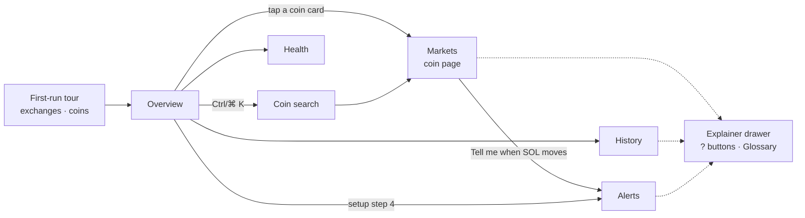

# Phase 1 UX: watch, store, explain

**Prototype:** [`phase1-prototype.html`](phase1-prototype.html). Open it in a browser; it is
self-contained and uses sample data. All five screens, the tour, the coin search, the explainer
drawer and the alert builder are clickable.

Phase 1 delivers the always-on backend and stored history (`ROADMAP.md` → Phase 1). The UI for
this phase does one job: **let anyone see live markets and trust the data behind them, without
needing to know trading jargon.** Signals and confirmations come later (Phases 3–6) and slot
into the same shell.

## Features in Phase 1

| # | Feature | Why it's in Phase 1 | Backend it needs |
| --- | --- | --- | --- |
| 1 | **Overview**: hero summary sentence, watchlist cards (price, 24 h line, funding, live/slow), "Worth a look" notes, setup checklist | One glance answers "what's happening and is it live?" | `/symbols`, `/prices` (WS), `/funding`, `/health` |
| 2 | **Markets (coin page)**: candle chart with candle-size switch, funding history, "In plain words" box, key numbers | First screen that uses **stored** history | `/candles`, `/funding?from=` |
| 3 | **History**: what's stored per coin × exchange, gaps being refilled, data-quality score, loading queue, "Load history for another coin" | Phase 1's core deliverable made visible; builds trust before any backtest | `/coverage`, `/quality`, `/backfill` (POST + progress) |
| 4 | **Alerts**: sentence-style builder, list with on/off switches, Telegram setup in three steps | Most-requested basic feature; replaces the browser-only alert engine with server-side checks | `/alerts` CRUD, Telegram worker |
| 5 | **Health**: per-exchange cards in plain words, collector stats | Data you can't trust is worse than no data | `/health` |
| 6 | **First-run tour** (3 steps: welcome, exchanges, coins) | New users get a working watchlist in under a minute | `/watchlist` |
| 7 | **Coin search** (Ctrl/⌘ K) and **explainer drawer** ("?" buttons + Glossary) | The app explains itself in place, instead of in a manual | none (static copy) |

Not in Phase 1: order book, spread panel and the full indicator picker stay on today's
dashboard until they move to the backend (Phase 3). Confirmations, strategies and risk screens
are Phases 3–6 (see the earlier canvas design for their layout).

## Screen flow

## Self-explaining rules (apply to every screen)

1. **Every screen opens with one sentence** saying what it shows (panel subtitles).
2. **Plain words first, numbers second.** "Longs pay shorts every 8h" sits next to `+0.041%`.
   System-written notes are labelled as observations, never advice.
3. **Every unfamiliar term has a "?"** that opens the explainer drawer. No hover-only tooltips,
   so they work on phones.
4. **State is shown in words and shape, not colour alone:** "Live / Slow / Down" pills with a
   dot, ▲▼ with +/−.
5. **Write controls as actions:** "Create alert", "Load history for another coin", "Send a test
   message". The confirmation toast repeats it ("Alert created").
6. **Errors say how to fix them:** "Enter a number, for example 190".
7. **Inputs explain their effect live:** the alert builder shows "SOL is at 182.41 now".
8. **No dead ends:** empty or not-set-up states link to the next step (setup checklist →
   Telegram).

## Visual language

| Token | Value | Use |
| --- | --- | --- |
| Ground | `#060A13` deep ink | page background |
| Data surface | `#0C1220` / raised `#131B2D` | panels, tables, inputs (solid, never glass) |
| Accent ("tide") | `#3DDCC4` sea-glass teal | primary actions, active nav, focus ring |
| Warning | `#F5B54A` amber | stale data, gaps |
| Up / down | `#4ADE80` / `#FB7185` | always paired with ▲▼ and +/− |
| Display face | Bricolage Grotesque | headings, hero |
| Body face | Manrope | text, controls |
| Data face | IBM Plex Mono, tabular numbers | every price and figure |

**Glassmorphism: only on floating chrome.** Sidebar/bottom bar, sticky top bar, the hero's
pulse cards, dialogs (tour, search), the explainer drawer and toasts. Data panels stay solid so
numbers keep full contrast. Recipe: translucent ink fill, a 1 px white-14% border, an inner top
highlight, `backdrop-filter: blur(18px) saturate(140%)`.

**Parallax: only in the Overview hero.** Three depth layers (aurora light, grid, rings) move at
different speeds on scroll and follow the pointer; the glass pulse cards drift the opposite way
for depth. It is disabled under `prefers-reduced-motion`. Everything is readable at rest.

**Layout:** a glass sidebar on desktop becomes a bottom tab bar under 960 px; panels wrap to one
column; wide tables scroll inside their own box. Touch targets are 44 px or larger.

## Acceptance criteria (for the real implementation)

- [ ] All five screens and the tour are built in `apps/web` against the Phase 1 API.
- [ ] Every number shown comes from the backend and shows its freshness.
- [ ] Every "?" has explainer copy; the glossary covers every term on screen.
- [ ] Text contrast is ≥ 4.5:1 on solid surfaces and on glass over the brightest hero area.
- [ ] Parallax and transitions are off under reduced motion; the hero is complete at rest.
- [ ] Works at 400 px width with no horizontal page scroll.
- [ ] Alerts fire with the browser closed and arrive on Telegram.
